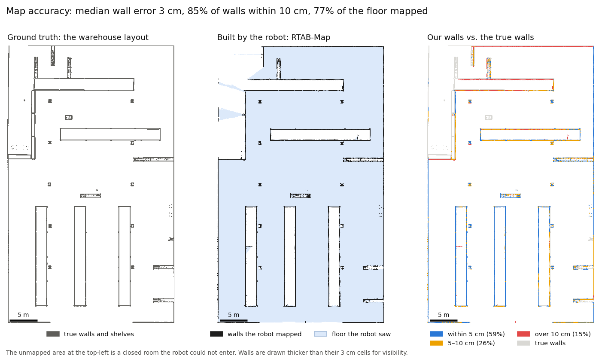

# TurtleBot 4: Mapping, Navigation and Vision-Based Docking in Simulation

A simulated TurtleBot 4 (ROS 2 Jazzy, Gazebo Harmonic) **maps a warehouse** with RTAB-Map, **navigates**
it with Nav2 on that map, and **docks to a charging dock using an AprilTag** seen by its camera. Each
stage is measured against simulator ground truth.



*Left: the warehouse's true layout. Middle: the map the robot built by driving itself around with RTAB-Map.
Right: each wall the robot mapped, coloured by its distance to the nearest true wall. 59% are within 5 cm and
85% within 10 cm. The larger errors (red) are mostly on the far outer wall and one shelf edge.*

## Results

| Stage | What was done | Result |
|---|---|---|
| **Mapping** | Autonomous 63-waypoint tour with RTAB-Map (RGB-D camera + 2D lidar + wheel odometry) | Median wall error **3 cm**, **85%** of walls within 10 cm, **77%** of reachable floor mapped (1,280 m²) |
| **Navigation** | Nav2 + AMCL on *our* map, 20 random goals across the warehouse | **20/20** goals reached, 443 m driven, 50 s mean per goal |
| **Docking** | Nav2 docking server driven by an AprilTag on the dock, vs. the same server using the map pose only | On 20 fresh start poses, AprilTag docking ends **1.1 cm** (depth) and **0.3 cm** (sideways) from the true dock pose (median), **20/20** within ±3 cm / ±2 cm; map-only docking stops **25.7 cm** short (median), **1/20** within. Heading stays 7.6° off (median) |

### Docking in detail

| Dock pose source | Start poses | Action reports success | Depth error, cm: median (p90) | Sideways error, cm: median (p90) | Heading error, deg: median (p90) | Within ±3 cm / ±2 cm | Also within ±3° |
|---|---|---|---|---|---|---|---|
| Map pose only (AMCL) | seed 0 | 19/20 | 26.8 (65.9) | 2.6 (5.5) | 2.0 (2.6) | 0/20 | 0/20 |
| AprilTag, calibrated at 0.7 m | seed 0 | 20/20 | 2.8 (3.1) | 5.6 (6.0) | 5.6 (7.7) | 0/20 | 0/20 |
| Map pose only (AMCL) | seed 1 | 20/20 | 25.7 (48.1) | 2.0 (7.0) | 1.6 (3.8) | 1/20 | 1/20 |
| AprilTag, + position bias correction (fitted on seed 0) | seed 1 | 20/20 | 1.1 (1.3) | 0.3 (0.6) | 7.6 (10.8) | 20/20 | 0/20 |

All errors are the robot's final pose from Gazebo ground truth, in the dock's frame; p90 = 90th percentile of |error|.
Each pair of rows uses the same 20 random start poses (seed 0, then a fresh seed 1).

- **Map pose only:** the docking server reports success almost every time, but the robot is really ~26 cm short
  (up to ~0.5–0.7 m): the dock pose comes from AMCL, whose error goes straight into the dock approach.
- **AprilTag, first calibration (seed 0):** extremely repeatable (SD 3 mm) but offset by the same −2.8 cm / −5.6 cm
  every time, i.e. a calibration bias, not noise.
- **AprilTag with the bias removed (seed 1):** the mean position offset measured on seed 0 is subtracted from
  the tag-to-dock calibration ([`apply_bias_correction.py`](scripts/apply_bias_correction.py)) and tested on
  new start poses: median error 1.1 cm depth, 0.3 cm sideways; all 20 within the position tolerance.
- **Heading is the remaining gap (7.6° median).** The docking server decides it is docked on position alone, so
  the final heading is whatever the controller's curved approach to that point leaves. Correcting heading as if
  it were an estimate error was tried and made it worse (+23°), so it is reported as is.

## What is built here vs. what ships with ROS

Being precise about this matters, because the TurtleBot 4 packages already contain some docking pieces.

| Ships with ROS 2 Jazzy (not claimed) | Built in this project |
|---|---|
| Nav2, AMCL, RTAB-Map, the Nav2 docking server (`opennav_docking`), `apriltag_ros` | The mapping tour (waypoints chosen from free space, Nav2 parameters for driving while the map grows) |
| Nav2's minimal TurtleBot 4 simulation and warehouse world | The **dock model with an AprilTag** (the simulation has no dock) |
| | A relay that turns AprilTag detections into the docking server's input (PnP pose from the tag corners) |
| | Calibration of the tag-to-dock transform from ground truth |
| | Evaluation: map accuracy vs. the true layout, navigation trials, docking trials scored by ground truth |

## How it works, step by step

**1. Simulation.** Nav2's minimal TurtleBot 4 simulation (`nav2_minimal_tb4_sim`, warehouse world) in Docker.
The robot has a 2D lidar, an RGB-D camera (320×240) and wheel odometry. On a laptop (Intel i7-1355U, iGPU)
the simulation alone runs at real-time speed (real-time factor 1.0) in about 3 GB of RAM, and at about 0.85×
with Nav2 running.

**2. Mapping** ([`scripts/run_mapping.sh`](scripts/run_mapping.sh)). RTAB-Map builds the map from wheel
odometry (motion), the lidar (occupancy grid, scan matching) and the RGB-D camera (visual loop closures).
The robot drives itself: waypoints are picked on a 4 m grid of free space with 0.7 m clearance
([`make_waypoints.py`](scripts/make_waypoints.py)) and sent to Nav2 one by one. While the map is still
growing, Nav2 plans on live lidar obstacles over a fixed warehouse-sized area, because a costmap sized to
the partly built map would reject goals outside it ([`make_nav2_mapping_params.py`](scripts/make_nav2_mapping_params.py)).
The finished map is scored against the warehouse's ground-truth map ([`compare_map.py`](scripts/compare_map.py)).

**3. Navigation** ([`scripts/run_navigation.sh`](scripts/run_navigation.sh)). Standard Nav2 with AMCL
localization on the saved map; 20 random goals (seeded) at least 5 m apart ([`nav_eval.py`](scripts/nav_eval.py)).

**4. Docking** ([`scripts/run_docking.sh`](scripts/run_docking.sh)).
- *Dock and tag:* a dock model with an AprilTag (tag36h11 #0, 20 cm) at camera height
  ([`models/dock_apriltag`](models/dock_apriltag)); the tag image is rendered by the AprilTag library
  itself ([`make_tag.py`](scripts/make_tag.py)).
- *Detection:* `apriltag_ros` finds the tag; [`dock_pose_relay.py`](scripts/dock_pose_relay.py) solves its
  3D pose from the four corners (OpenCV `solvePnP`, IPPE_SQUARE) and publishes it to the docking server.
- *Calibration:* where the dock is relative to the tag is measured once from ground truth
  ([`calibrate_tag.py`](scripts/calibrate_tag.py)) and given to the docking server as its
  `external_detection_*` offsets.
- *Trials* ([`dock_trials.py`](scripts/dock_trials.py)): drive to a random start 1.5–3.5 m in front of the
  dock (±60°, random heading), call Nav2's `DockRobot`, then read the robot's true final pose from Gazebo.
  Error is measured in the dock's frame: depth (x), sideways (y) and heading. A trial counts as docked when
  the action succeeds and the error is within ±3 cm depth, ±2 cm sideways, ±3°.
- *Two modes, same 20 start poses:* **AprilTag** (the final approach follows the detected tag) and
  **map-only** (the dock pose comes from the map, so accuracy depends on AMCL localization).
- *Bias correction:* the constant offset of the first AprilTag set (seed 0) is removed from the calibration,
  and the result is validated on different start poses (seed 1).

## Reproduce

Docker on Linux (tested on Ubuntu 26.04, Intel iGPU).

```bash
docker build -t tb4-nav-docking:jazzy docker/
scripts/run_mapping.sh                 # sim + RTAB-Map + Nav2 tour; map -> outputs/maps/
scripts/exec.sh "python3 scripts/compare_map.py outputs/maps/warehouse_rtabmap.yaml"   # (sim running)
scripts/run_navigation.sh 20 0         # 20 goals on results/maps/warehouse_rtabmap.yaml
scripts/run_all_docking.sh 20 1        # AprilTag and map-only docking trials on start poses seed 1
python3 scripts/docking_report.py      # results/docking/table.md
scripts/exec.sh "python3 scripts/make_map_figure.py"   # docs/map_figure.png (needs scripts/up.sh running)
```

`config/tag_calibration.yaml` holds the bias-corrected calibration (the seed-1 AprilTag row); the first
calibration (the seed-0 AprilTag row) is kept in it as `docking_server_uncorrected`.
`scripts/up.sh` starts the simulation container and `scripts/exec.sh "<cmd>"` runs a command in it.
`config/sim.env` holds the world, spawn pose and dock pose. Debugging and validation helpers:
`rtf.py` (real-time factor), `scan_probe.py`, `depth_probe.py`, `costmap_probe.py`, and
`check_dock_estimate.py` / `probe_estimate_vs_range.py` (dock estimate vs ground truth).

## Problems hit along the way

- **The stock TurtleBot 4 simulation's lidar is broken in Jazzy:** every beam reads its 0.164 m minimum, so
  Nav2 sees the robot boxed in ([turtlebot4#676](https://github.com/turtlebot/turtlebot4/issues/676)). It
  also ran at 0.3× real time with 7–8 GB of RAM here. Nav2's own minimal TurtleBot 4 simulation has the same
  sensors, a working lidar, real-time speed and 3 GB, so it is used instead.
- **RTAB-Map publishes its map on `/rtabmap/map`**, not `/map` where Nav2 listens.
- **SLAM frames:** RTAB-Map's map frame starts at the robot's spawn pose, not the world origin, so
  world-frame waypoints and costmap bounds are transformed into it.
- **ROS 2 services timing out** inside the container: stale shared-memory segments from earlier root-run
  containers broke Fast DDS's shared-memory transport. Fixed by running DDS over UDP only, without the host IPC
  namespace, and running the container as the host user.
- **Detections dropped by the relay:** looking up `apriltag_ros`'s TF after each detection lost about half of
  them, which tripped the docking server's 1 s detection timeout. Computing the pose from the corners in the
  detection message itself removed the dependency on TF timing.
- **The docking server's default 5 cm `docking_threshold`** ends docking 5 cm early when no charging contact
  is sensed (as in simulation); it is set to 1.5 cm for both modes.

## Limitations

Simulation only, one world, one dock position, 20 trials per setting. The camera is low resolution (320×240).
Docking accuracy is judged from ground-truth poses rather than electrical contact, and the final heading is not
controlled by the stock docking server's position-based finish.
